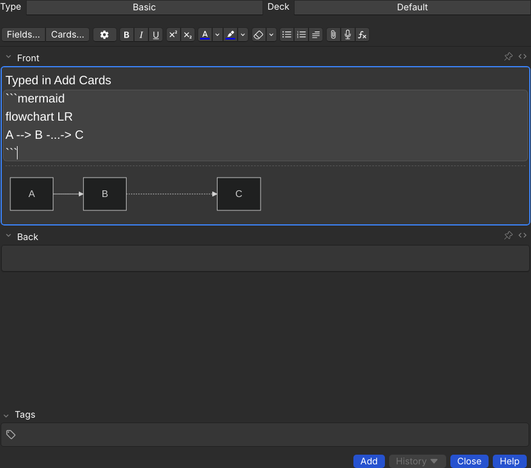
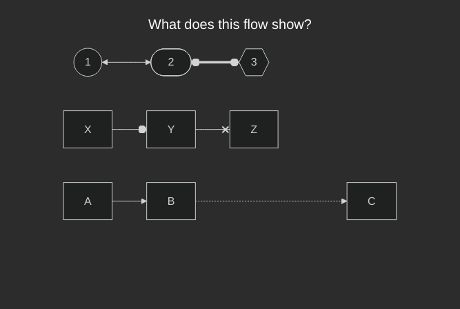

# Mermaid Diagrams for Anki

An Anki add-on that turns ` ```mermaid ` code blocks typed into a note field
into [Mermaid](https://mermaid.js.org) diagrams, on the card and live in the
note editor.

| Editing | Reviewing |
| --- | --- |
|  |  |

## Use

Type a fenced block into any field, each fence on its own line:

    ```mermaid
    flowchart LR
    A --> B -...-> C
    ```

- **In the editor** the block sits in a shaded box and the diagram is drawn
  beneath the field, updating as you type. While the source does not parse,
  the last good drawing stays on screen, dimmed, with Mermaid's error under it.
- **On the card** (review, preview and the card layout screen) the block is
  replaced by the diagram. A block Mermaid cannot draw is shown as a code box
  with the error message.
- Light and dark mode follow Anki.

The add-on only draws. It never changes what is stored in the note: the field
holds exactly the text you typed.

## Install

Build the package and install it from Anki's **Tools > Add-ons > Install from
file...**, then restart Anki:

```bash
python3 tools/build_addon.py
```

This writes `dist/anki_mermaid.ankiaddon`. To work on the add-on instead, link
the `anki_mermaid` folder into Anki's `addons21` folder.

Tested with Anki 26.09.4 (Qt 6.11), in both the standard and the new
experimental editor. Mermaid 12 needs a recent browser engine, so older Anki
releases may not be able to run it.

## Settings

**Tools > Add-ons > Mermaid Diagrams > Config**

| Key | Default | Meaning |
| --- | --- | --- |
| `theme_light` | `default` | Mermaid theme in light mode |
| `theme_dark` | `dark` | Mermaid theme in dark mode |
| `look` | `classic` | `classic`, `neo` or `handDrawn` |
| `layout` | `dagre` | `dagre` or `elk` |

A single diagram can override these with Mermaid's own frontmatter.

## Limits

- **Desktop only for now.** AnkiDroid, AnkiMobile and AnkiWeb show the block
  as plain text, because they cannot run add-ons.
- Do not put cloze deletions inside a block. Anki rewrites the text inside a
  cloze, which corrupts the diagram source.
- In the editor the code keeps the field's font. A monospace font would need
  extra markup saved into the note, which the add-on avoids.
- With the `dagre` layout, Mermaid stacks unconnected chains in the reverse of
  the order they are written. `elk` keeps the written order but ignores extra
  link length such as `-...->`.

## Development

```bash
node tests/run.js
```

runs the browser tests (Playwright with Chromium). The pages in `tests/pages`
mimic Anki's reviewer and editor, including the editor's content security
policy, and load the add-on's real files. Screenshots go to `tests/output/`.

Layout:

- `anki_mermaid/__init__.py` wires the scripts into Anki's webviews.
- `anki_mermaid/web/anki-mermaid.js` finds the blocks and renders them.
- `anki_mermaid/web/editor.js` draws the editor's code box and live preview.
- `anki_mermaid/web/vendor/` holds Mermaid 12.3.0 (MIT licence).
